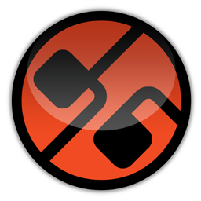

  

<h1 align="center">D16 Group Decimort</h1>

  

---

## Overview

D16 Group Decimort 2 is a meticulous bit-depth and sample-rate reduction plugin that emulates the aliasing artifacts of vintage samplers and early digital hardware with exceptional accuracy.

Whether you're a newcomer just getting started or a seasoned pro looking for advanced tools, **D16 Group Decimort** delivers the features you need in a clean, intuitive package.

---

## Key Features

| Feature | Description |
|---------|-------------|
| **Bit Crush** | 1–24 bit depth reduction with multiple quantization dither modes |
| **SRC Aliasing** | Accurate sample-rate reduction aliasing matching vintage ADC/DAC chips |
| **Jitter** | Clock jitter simulation for additional vintage digital artifacts |
| **Mix Control** | Wet/dry blend for parallel lo-fi and clean signal combination |

---

## System Requirements

| Component | Minimum | Recommended |
|-----------|---------|-------------|
| **OS** | Windows 10 / macOS 11 | Windows 11 / macOS 13+ |
| **RAM** | 4 GB | 8 GB+ |
| **Storage** | 500 MB | 2 GB+ |
| **Internet** | Required for activation | Broadband recommended |

---

## Installation

Getting started with **D16 Group Decimort** is quick and straightforward.

1. **Download** the installer for your operating system above
2. **Run** the installer and follow the on-screen instructions
3. **Launch** D16 Group Decimort from your desktop or applications folder
4. **Configure** your preferences in the settings panel

---

## Community & Stats

---

## Support the Project

---

## License

This project is distributed under a free-to-use license. See the repository for full license details.

**Made with ❤️ for the Audio Effects community**

